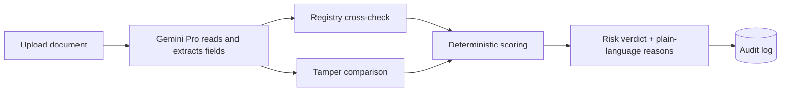

<p align="center">
  
</p>

<h1 align="center">MedTrust</h1>

<p align="center">
  <b>A trust layer for medical paperwork, built for the AI era.</b><br/>
  Verify prescriptions and lab reports in seconds — and see exactly why a document was flagged.
</p>

<p align="center">
  
  
  
  
</p>

---

## Overview

Prescriptions get altered. Doctors' signatures get copied. Lab values get changed to pass an insurance test. Today, catching this depends on a pharmacist's eye or a claims reviewer's instinct, which is slow, inconsistent, and easy to fool under time pressure.

**MedTrust** is a website that reads an uploaded prescription or lab report, checks it against records the issuing hospital or lab has already registered, and returns a clear **Low / Medium / High risk verdict with plain-language reasons**.

It is built for:

- **Pharmacists** verifying a prescription before dispensing
- **Insurance reviewers** validating lab reports and claims
- **Hospitals, labs, and pharmacy chains** registering their templates, doctors, and records
- **Patients and caregivers** who want to understand or double-check their own documents

> **Project status:** MedTrust is currently in the design and documentation phase. The requirements, data flow diagrams, and architecture are complete; implementation follows the phased plan below.

## The four fraud cases it catches

| # | Problem | How MedTrust catches it |
|---|---------|-------------------------|
| 1 | Prescription dosage or quantity edited after issue | Cross-checks the uploaded prescription against the hospital's own e-prescription record |
| 2 | A doctor's signature copied onto a fake prescription | Validates the signature and doctor ID combination against the partner hospital's registered doctor list |
| 3 | Lab report values changed to pass an insurance test | Retrieves the original result by report ID and compares it value-by-value with the uploaded copy |
| 4 | Fake or irrelevant scans/prescriptions endorsed for a disease the patient doesn't have | An ML relevance check tests whether the scan or medicine actually fits the claimed condition |

A fifth, supporting check looks across registered pharmacies for **overlapping controlled-substance prescriptions** for the same patient (a doctor-shopping pattern).

## How it works



**Design principle:** Gemini Pro handles *perception and explanation* (reading documents, comparing them against registered templates, and describing findings in plain language, including regional languages). The actual **pass/fail decision runs on deterministic, auditable registry-matching code**, because a healthcare decision needs a traceable trail, not just a probabilistic guess. A High Risk result routes to human review; it never auto-rejects a patient.

## Features

- **Document reading:** structured field extraction (patient, medicine, dosage, dates, doctor ID, report values) from scanned or photographed documents
- **Registry cross-checks:** dosage/quantity, doctor signature and ID, and lab values against partner records
- **Tamper detection:** image-forensics checks (Error Level Analysis) plus template comparison
- **Medical relevance check:** ML model flags scans/medicines that don't fit the claimed disease
- **Cross-pharmacy pattern detection:** flags overlapping controlled-substance prescriptions
- **Institution portal:** register document templates, doctor signatures and IDs, and connect e-prescription and lab record sources
- **Audit dashboard:** every verification logged and filterable by risk level, document type, and date range
- **Patient Learn module:** plain-language guides and a question-answering assistant (never gives dosing advice)

## Tech stack

| Purpose | Technology |
|---------|------------|
| Website (verifier + institution portal) | React |
| Backend API | Python, FastAPI |
| Database | PostgreSQL |
| Document understanding, comparison, explanations | Gemini Pro API |
| Image forensics (tamper detection) | OpenCV, Pillow |
| Medical relevance model | scikit-learn |
| Authentication | JWT with role-based access control |
| Deployment | Docker on a Linux server |
| Version control | Git and GitHub |

## Website pages

| Page | Key elements |
|------|--------------|
| Home | Links to sign up and to verify a document |
| Sign up / Login | Role dropdown (Hospital/Institution, Pharmacy, Insurance reviewer, Patient) |
| Institution portal | Institution type, license number, document type dropdown, template upload |
| Dashboard | Filters for risk level, document type, and date range over past verifications |
| Verifier | Document type dropdown, file upload, verdict panel with reasons |
| Learn | Topic filter, plain-language guides, question box |

## Documentation

| Document | Description |
|----------|-------------|
| [`docs/MedTrust_SRS_2026.docx`](docs/MedTrust_SRS_2026.docx) | Software Requirements Specification (features, REQ-tagged requirements, interfaces, plan) |
| [`docs/MedTrust_DFD_Report.docx`](docs/MedTrust_DFD_Report.docx) | Data Flow Diagrams: Level 0, Level 1, and Level 2 decompositions of every entity-linked process |
| `docs/` use case diagram | Use case diagram (StarUML) with `<<include>>` and `<<extend>>` relationships *(in progress)* |

## Project plan

| Phase | Focus | Timeline |
|-------|-------|----------|
| 1 | Requirement gathering and planning | Weeks 1-2 |
| 2 | Design (UI/UX, architecture, DB schema, Gemini prompt design) | Week 2 |
| 3 | Core frontend and backend setup | Weeks 3-4 |
| 4 | Document reading and Gemini integration | Weeks 5-6 |
| 5 | Fraud detection engine (the four cases) | Weeks 7-9 |
| 6 | Audit trail, dashboard, and security hardening | Weeks 10-11 |
| 7 | Testing (unit, integration, UAT) | Week 12 |
| 8 | Deployment setup (CI/CD, hosting, SSL) | Weeks 12-13 |
| 9 | Go-live, documentation, and handover | Week 13 |

## Getting started

> The commands below describe the intended repository layout and will be finalized as implementation lands.

```bash
# clone
git clone https://github.com/<your-username>/medtrust.git
cd medtrust

# backend
cd backend
python -m venv venv
source venv/bin/activate        # Windows: venv\Scripts\activate
pip install -r requirements.txt
cp .env.example .env            # add GEMINI_API_KEY and database settings
uvicorn app.main:app --reload

# frontend (in a second terminal)
cd frontend
npm install
npm run dev
```

## Repository layout (planned)

```
medtrust/
├── assets/          # logo and images
├── backend/         # FastAPI app: verification engine, registry checks, auth
├── frontend/        # React website: portal, verifier, dashboard, Learn
├── docs/            # SRS, DFDs, use case diagram
├── data/            # synthetic test documents only
└── docker-compose.yml
```

## Data and privacy

- **No real patient data** is used in development or testing. All test documents are synthetic or self-created.
- Uploaded documents are encrypted in transit and at rest, and access is restricted by role.
- The design takes India's Digital Personal Data Protection Act (DPDP Act, 2023) into account for any pilot deployment.
- MedTrust is a **risk-scoring assistant**, not a legal or clinical authority. Flagged documents are routed to human review.

## Known dependencies

MedTrust's registry checks depend on partner hospitals and labs sharing e-prescription records, doctor signature/ID registries, and report lookup by ID. Pilot partners and exact integration formats are still to be determined.

## Team

| Name | Focus |
|------|-------|
| **Akshita K** | Cybersecurity, networks, data science: fraud detection logic, registry cross-checks, authentication and security, deployment |
| **Akshita H** | AI/ML: Gemini Pro integration, document extraction pipeline, medical relevance model |
| **Ami** | Full stack: website, backend API, database, documentation |

## License

To be decided. Add a `LICENSE` file before making the repository public.
